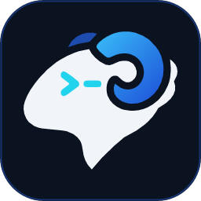

# Herdr for VS Code



> **Unofficial.** A community extension for [herdr](https://herdr.dev), not made or endorsed by its authors.

Herdr is the terminal workspace manager for AI coding agents. This extension brings
its agents into VS Code: live status in the status bar and activity bar, quick
switching, focus-on-blocked, and file references in each harness's own syntax —
while the agents keep running in herdr and the terminal stays the native VS Code
terminal.

> **Status:** pre-1.0 (`0.4.0`). This is a new Marketplace listing
> (`xicu.herdr-vscode`) that supersedes `xicu.herdr-companion`: VS Code keys
> updates on the extension ID, so the old listing will not update into this one.

## Features

- **Live status, no polling.** Herdr's events drive the UI. The status bar shows
  how many agents are blocked or working; the **Herdr** activity-bar view lists
  every herdr workspace and its agents with status icons.
- **Focus on blocked.** When an agent *transitions* into blocked, its conversation
  is revealed and a notification appears. Already-blocked agents at startup never
  steal focus.
- **Fast switching.** A QuickPick sorted blocked-first, plus next/previous
  navigation in herdr's tab order. Clicking the status bar jumps straight to a
  blocked agent.
- **One native terminal.** The extension hosts a single herdr TUI terminal with
  its own session, so VS Code windows do not clutter the desktop session. Native
  terminal search, links, scrollback and accessibility all keep working.
- **Send references.** Select code and run **Herdr: Send Selection to Agent** (or
  the editor context menu). The active harness receives `@path#L10-20` in the
  syntax it understands.
- **Drag and drop.** Drop files from Explorer or your file manager onto an agent
  conversation in the Herdr activity-bar view. Multiple files use that agent's
  mention syntax; dropped text is inserted directly, with multiline text sent as
  bracketed paste. Content is inserted without submitting the prompt.
- **Agents open files.** Agents can run `code --reuse-window --goto "path:line:column"`
  to show a file in the editor. **Herdr: Install Agent Skill (Open Files in VS Code)**
  adds instructions to the selected workspace for Codex and Claude Code.
- **Rename tabs** without leaving VS Code, and close a conversation without
  destroying its workspace.
- **Multi-root folders.** New conversations use the active editor's folder; the
  status bar and tree cover every herdr workspace, not just the open folder.
- **Remote-friendly.** The extension runs where your code runs (Remote-SSH, WSL,
  dev containers), so it talks to the herdr installed there.

## Requirements

- VS Code 1.85 or newer.
- [herdr](https://herdr.dev) installed on the machine where the extension host
  runs. The extension uses its own named `vscode` session; **Herdr: Open Herdr
  Terminal** starts it for you, or start it headlessly:

  ```sh
  herdr --session vscode server
  ```

- Linux or macOS. Windows is not supported yet.

The extension talks to herdr over its local Unix socket. It does not need
herdr-bridge, and it sends nothing off your machine.

## Install

Once the Marketplace listing is live:

```sh
code --install-extension xicu.herdr-vscode
```

Or search for **Herdr for VS Code** in the Extensions view. Until then, build a
VSIX from source (`npm run package`) and use **Extensions: Install from VSIX…**.

## Getting started

1. Run **Herdr: Open Herdr Terminal** (or click the offline status bar item).
   This starts the extension's isolated `vscode` session; `herdr.autoStart` can
   do it in the background instead.
2. Open a folder in VS Code and click the Herdr icon in the activity bar.
3. Run **Herdr: New Agent Conversation** and pick a harness.
4. The agent appears in the Herdr view and the status bar. Click it to switch.

Commands are available from the Command Palette (`Ctrl/Cmd+Shift+P`) and can be
bound to keys in **Keyboard Shortcuts**.

## Commands

| Command | Description |
| --- | --- |
| `Herdr: Switch Agent Conversation` | QuickPick of agents, blocked first. |
| `Herdr: Next / Previous Agent Conversation` | Cycle in herdr's tab order. |
| `Herdr: New Agent Conversation` | Pick a harness and start it in this folder. |
| `Herdr: New Shell Tab` | Open a plain shell in this folder's workspace. |
| `Herdr: Rename Agent Tab` | Rename the active (or picked) tab in herdr. |
| `Herdr: Close Conversation` | Close a tab, leaving a shell if it was the last one. |
| `Herdr: Send Selection to Agent` | Insert a file/line reference into the active agent. |
| `Herdr: Install Agent Skill (Open Files in VS Code)` | Install file-opening instructions in the selected workspace. |
| `Herdr: Open Herdr Terminal` | Reveal the herdr TUI terminal. |
| `Herdr: Focus Workspace` | Focus the active folder's workspace, or the one selected in the tree. |
| `Herdr: Refresh Agents` | Force a snapshot refresh. |
| `Herdr: Diagnose Connection` | Show socket, session, workspace and tab state. |

## Settings

| Setting | Default | Description |
| --- | --- | --- |
| `herdr.focusOnBlocked` | `true` | Reveal a conversation when it *transitions* into blocked. |
| `herdr.session` | `vscode` | Named herdr session, isolated from the desktop session. |
| `herdr.autoStart` | `false` | Start `herdr server` when no socket exists. |
| `herdr.defaultHarness` | `claude` | Harness listed first in the new-conversation picker. |

## How it works

- **Transport.** A direct Unix-socket connection to herdr (`session.snapshot`,
  `events.subscribe`, and the tab/workspace/agent RPCs). Structural events
  (workspaces, tabs, panes) are global; agent status changes are subscribed per
  pane, because herdr requires a `pane_id` for them. Events trigger one queued
  snapshot, and the event stream reconnects with backoff. No polling.
- **Workspace mapping.** Each VS Code workspace folder maps to one herdr
  workspace, found by pane `cwd` with a label fallback and created on demand. New
  conversations use that workspace, or the one chosen in the tree. The status bar
  and tree are session-wide: agents running outside the open folder are still
  visible and one click away.
- **Terminal.** One `herdr` TUI terminal per VS Code window, launched with the
  configured session and without inherited `HERDR_*` pane variables. Switching
  conversations focuses the matching herdr workspace and tab and reveals that
  terminal.
- **References.** Each harness gets its own mention syntax:

  | Harness | Reference |
  | --- | --- |
  | Claude Code, unknown | `@path#L10-20` |
  | opencode | `@path#L10-20` |
  | Codex | `path:10-20` |
  | Copilot, Grok, Antigravity | `@path:10-20` |
  | pi | `@path:10-20` |
  | Unknown harness | `@path#L10-20` |

  Paths are relative to the folder; files outside it are sent absolute. Sending
  is refused when the active tab is a shell rather than an agent.
- **Drops.** The Herdr view accepts file URI lists, files and selected text on
  agent conversations. References are relative to the target pane's working
  directory. Drops and editor references go directly to that pane through
  `pane.send_text`, without relying on terminal focus. In remote windows, dropped
  files must already exist on the remote machine; local files are not uploaded.
  VS Code's native terminal handles its own drops; the extension's harness-aware
  drop target is the conversation in the Herdr view.
- **Opening files from agents.** The installed skill uses VS Code's existing
  `code --reuse-window --goto` CLI, with one-based lines and columns, and requires
  no bridge. New tabs inherit `VSCODE_IPC_HOOK_CLI` from the extension host when
  available, routing CLI requests to the originating window. Otherwise the CLI
  uses the last active window. In remote environments, use VS Code's remote
  `code` CLI. The command installs `.agents/skills/herdr-open-vscode/SKILL.md` and
  a `.claude/skills/herdr-open-vscode` symlink; existing files and links are
  preserved. Restart existing agents to discover newly installed skills.

## Troubleshooting

- **`Herdr (offline)`.** Click the status bar item to start the terminal/session,
  or run **Herdr: Diagnose Connection** for the socket path and last error. The
  binary being on `PATH` is not enough: the configured session's socket must
  exist.
- **A different session's tabs.** `herdr.session` must match the session you
  started. Changing it restarts the extension's herdr terminal.
- **Remote windows.** Install and run herdr on the remote machine, not only
  locally.
- **Wrong terminal focus after switching.** Some terminal shells swallow the
  focus RPC while a TUI is redrawing; click the terminal once and subsequent
  switches normally follow.

## Development

```sh
npm install
npm run compile   # tsc
npm test          # vitest: resolver, notifier, mention syntax
npm run package   # build a .vsix with @vscode/vsce
```

| Path | Responsibility |
| --- | --- |
| `src/extension.ts` | Activation, commands, status bar, terminal, refresh queue. |
| `src/herdrClient.ts` | Unix-socket RPC, snapshots, event stream with reconnect. |
| `src/resolver.ts` | Folder → workspace → conversation mapping, status order. |
| `src/notifier.ts` | Transition-only blocked notifications (pure, injectable). |
| `src/mentions.ts` | Per-harness file/line reference syntax. |
| `src/tree.ts` | Activity-bar Herdr view. |
